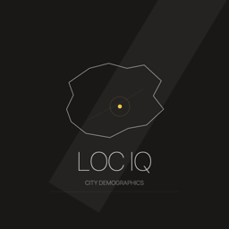

  

<h1 align="center">LOC IQ Support</h1>

  Help with LOC IQ, and how to get in touch. 
  <a href="https://chrismahlke.github.io/lociq/">Website</a> ·
  <a href="https://chrismahlke.github.io/lociq/privacy/">Privacy</a> ·
  <a href="https://github.com/ChrisMahlke/lociq/issues">Report a problem</a>

---

LOC IQ shows the city you're in, on one quiet screen: population, income, households, housing, and commuting from U.S. Census Bureau data, beside the cities that border it. It runs on iPhone, iPad, and Apple Watch, with no account, no ads, and no tracking.

This repository is the support channel for the app. To report a problem or suggest something, [open an issue](https://github.com/ChrisMahlke/lociq/issues/new) with your device, its iOS or watchOS version, and what you expected to see. The [support page](https://chrismahlke.github.io/lociq/support/) answers common questions.

---

  © 2026 M10 LLC · This product uses the Census Bureau Data API but is not endorsed or certified by the Census Bureau.

